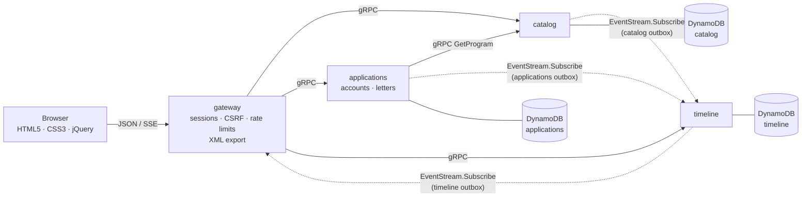

# Waypoint — Study Abroad Application Assistant

[](https://github.com/BohuaiSong2004/study-abroad-assistant/actions/workflows/ci.yml)

Waypoint helps prospective students plan applications to programs abroad. A
student picks programs and rounds; Waypoint turns each program's deadline and
requirements into a dated plan (documents, test scores, recommendation letters,
submission) and **keeps every plan in sync across services** when a counselor
changes a deadline, a document is ticked off, or a recommender submits a letter.

> **About this repository.** This is a 2026 rebuild of a project I first built
> during a training program; the original code was lost. The commit history is
> the real history of the rebuild. It runs locally (Docker Compose or plain
> `go run`), but it is **not deployed to AWS**: the Terraform in
> [`deploy/terraform`](deploy/terraform) is validated in CI, not applied, and the
> performance numbers below were measured against DynamoDB Local, not DAX. The
> program catalog is fictional sample data.

## What it does

- **Programs catalog** — search by university, field, country and degree; each
  program has rounds (deadlines in the program's own time zone) and requirements.
- **Synced application timelines** — milestones are generated from the round
  deadline (e.g. ask recommenders six weeks out, send test scores a month out)
  and re-planned automatically when anything they depend on changes. Students
  can add their own milestones; they survive re-planning.
- **Recommendation letters** — students invite recommenders with a secret link
  (no account needed); letters the student waived access to are never shown to
  them. Timelines update when letters arrive or a recommender declines.
- **Live updates** — open pages update over Server-Sent Events when a timeline
  changes in the backend (for example, a counselor edits a deadline).
- **XML export** — timelines and recommendation packets download as XML that
  validates against published XSD schemas ([`/schemas/timeline-v1.xsd`](internal/xmlexport/schemas/timeline-v1.xsd),
  [`/schemas/packet-v1.xsd`](internal/xmlexport/schemas/packet-v1.xsd)).
- **Counselor console** — edit programs and rounds; watch the sync streams.

## Architecture



- **Go gRPC services**, each owning one DynamoDB table (single-table design).
  Data crosses service boundaries only through gRPC calls and event streams.
- **Cross-service sync**: every write commits its domain event to a
  **transactional outbox** in the same DynamoDB transaction. Consumers tail it
  with a server-streaming `Subscribe` RPC, keep a durable cursor, apply events
  **in parallel per aggregate** with a watermark cursor, and are idempotent
  (version checks), so a crash or redelivery never corrupts a timeline.
- **Caching**: services read through a narrow `ddb.API` interface implemented by
  the AWS SDK client, the **DAX** client (`aws-dax-go-v2`, production) and an
  in-process **DAX-style read-through cache** (local/dev), selected with
  `CACHE_MODE=off|local|dax`. Because DAX's query cache ignores writes, CI
  also runs the system and browser tests with `CACHE_MODE=daxsim` (the local
  cache with DAX's contract); reads that must reflect a change use strongly
  consistent reads, which DAX passes through.

Details: [docs/architecture.md](docs/architecture.md) ·
Measurements: [docs/performance.md](docs/performance.md) ·
Bugs found along the way: [docs/engineering-notes.md](docs/engineering-notes.md)

## Quick start (Docker)

```sh
docker compose up --build
```

Open <http://localhost:8080>, create a student account, or sign in as the
counselor: `counselor@example.com` / `counselor-demo-password`.

The stack: DynamoDB Local, the three services, the gateway, and a one-shot job
that seeds ~40 sample programs.

## Development without Docker for the services

Requirements: Go 1.26+, and DynamoDB Local (Docker or the AWS jar).

```sh
docker run --rm -p 8000:8000 amazon/dynamodb-local   # terminal 1
./scripts/dev.sh                                     # terminal 2: builds, runs, seeds
```

`dev.sh` serves the UI from `web/static` on disk, so HTML/CSS/JS changes show
up on reload.

## Tests

| Suite | What | Run |
| --- | --- | --- |
| Go unit + integration | 59 test functions: planner rules, cache races, outbox gaps and tombstones, consumer resume/watermark/leases, full services over in-memory gRPC, gateway HTTP (CSRF, rate limits, SSE, XML) | `DYNAMODB_ENDPOINT=http://localhost:8000 go test -race ./...` |
| XML schemas | Every export validated with `xmllint` against the XSDs | part of the Go tests (needs `libxml2-utils`) |
| Browser (Playwright) | 16 end-to-end tests incl. live sync, no-JavaScript sign-in, axe accessibility, mobile layout | `cd e2e && npm ci && npx playwright install chromium && npx playwright test` (stack running) |
| Load (k6) | cache on/off, concurrent writes, deadline fan-out | see [docs/performance.md](docs/performance.md) |

Application-code coverage is about 83% (`go test -coverpkg=./internal/...`).
CI runs lint (golangci-lint, `buf lint`, generated-code check), the Go suites
against DynamoDB Local, Playwright against the dev-mode stack, a Docker Compose
smoke test and `terraform validate`.

## Performance (measured locally)

All on one 2-vCPU VM, services in Docker against DynamoDB Local; full method
and raw numbers in [docs/performance.md](docs/performance.md).

| | `CACHE_MODE=off` | `CACHE_MODE=local` |
| --- | --- | --- |
| `GET /timeline` median, 50 req/s | 3.24 ms | 1.51 ms (−53%) |
| `GET /programs/{id}` median, 50 req/s | 2.93 ms | 1.36 ms (−54%) |
| Program search median, 50 req/s | 12.2 ms | 1.7 ms (−86%) |
| Strongly consistent list (never cached, control) | 3.61 ms | 3.64 ms |
| Read mix throughput, 20 concurrent clients | 359 req/s | 1,659 req/s |
| Cache hit ratio (timeline / catalog items) | — | 99% / 99% |

Sync: a change is applied to the timeline in **22 ms median** (p95 49 ms) at
low load; a burst of 100 students making 500 changes in ~10 s is fully synced
with 0 errors (server-side p95 2.3 s); a deadline change re-plans **300
timelines in ~2 s**.

## Project layout

```
proto/                 gRPC API definitions (buf)       gen/  generated Go code
cmd/                   catalog, applications, timeline, gateway, seed
internal/
  catalog/ applications/ timeline/   service implementations
  events/              outbox, Subscribe server, consumer, leases, watermark
  ddb/                 DynamoDB/DAX client interface, tables, read-through cache
  gateway/             HTTP API, sessions, CSRF, SSE, static assets
  xmlexport/           XML encoders + XSD schemas
  platform/            config, logging, gRPC interceptors, internal auth
web/static/            HTML5/CSS3/jQuery UI
e2e/                   Playwright tests        loadtest/  k6 scripts, benchmarks
deploy/terraform/      AWS: DynamoDB, DAX, ECS Fargate, ALB, Cloud Map
```

## Configuration

| Variable | Default | Purpose |
| --- | --- | --- |
| `DYNAMODB_ENDPOINT` | (AWS) | e.g. `http://localhost:8000` for DynamoDB Local |
| `CACHE_MODE` | `local` | `off`, `local` (in-process cache), `daxsim` (local cache with DAX semantics, for tests) or `dax` |
| `DAX_ENDPOINT` | | `daxs://…` cluster endpoint when `CACHE_MODE=dax` |
| `INTERNAL_TOKEN` | dev value | shared secret between gateway and services (required in production) |
| `PUBLIC_URL` | `http://localhost:8080` | origin used for invitation links and the CSRF check |
| `TRUSTED_PROXIES` | | CIDRs whose `X-Forwarded-For` is trusted (the load balancer) |
| `AUTH_RATE_PER_MIN` | `20` | gateway (per replica): sign-in/sign-up attempts per client IP per minute |
| `LOGIN_LIMIT_PER_IP` | `60` | applications (shared): sign-in attempts per address per 10 minutes |
| `LOGIN_FAILURES_PER_ACCOUNT` | `10` | applications (shared): failed sign-ins per account per 15 minutes before lockout |
| `REGISTER_LIMIT_PER_IP` | `20` | applications (shared): sign-ups per address per hour |
| `CONSUMER_WORKERS` | `8` | parallel event appliers per stream (per-aggregate order kept) |
| `BOOTSTRAP_COUNSELOR_EMAIL` / `_PASSWORD` | | creates the first counselor account |

## Known limitations

- Recommendation invitations are not emailed: the student copies the link or
  opens a prepared `mailto:`.
- Program search filters the listing index in DynamoDB, which is fine for a
  catalog of a few thousand programs; a much larger catalog would use a search
  engine.
